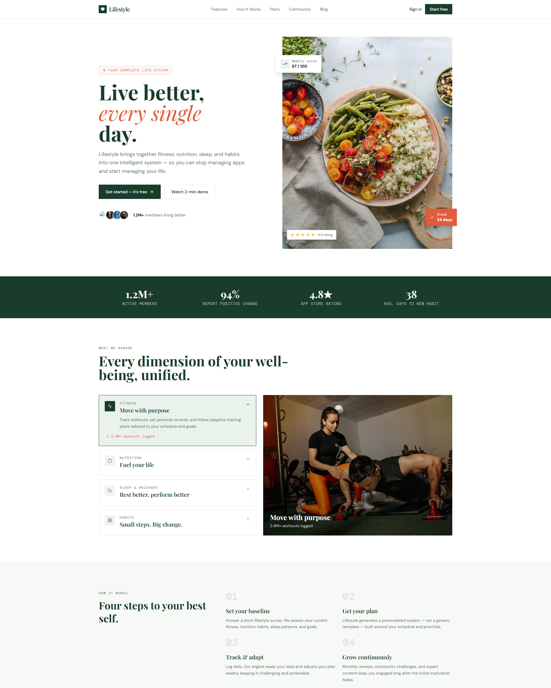
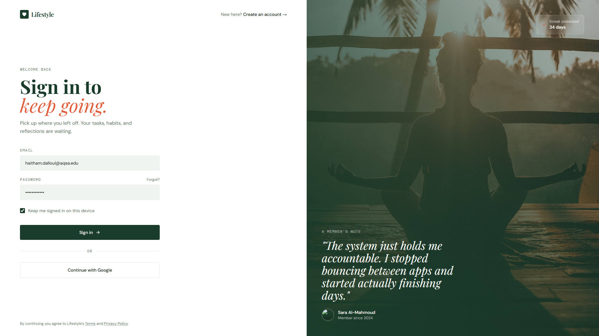
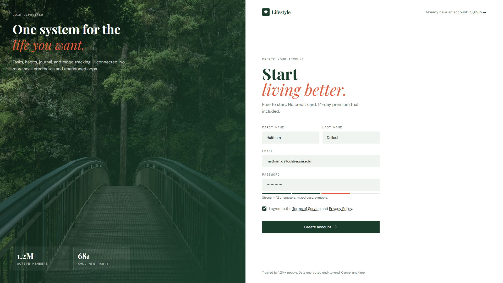
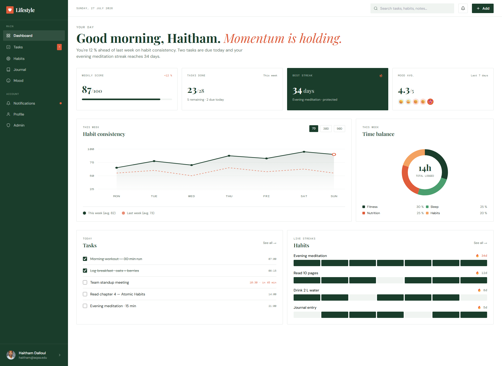
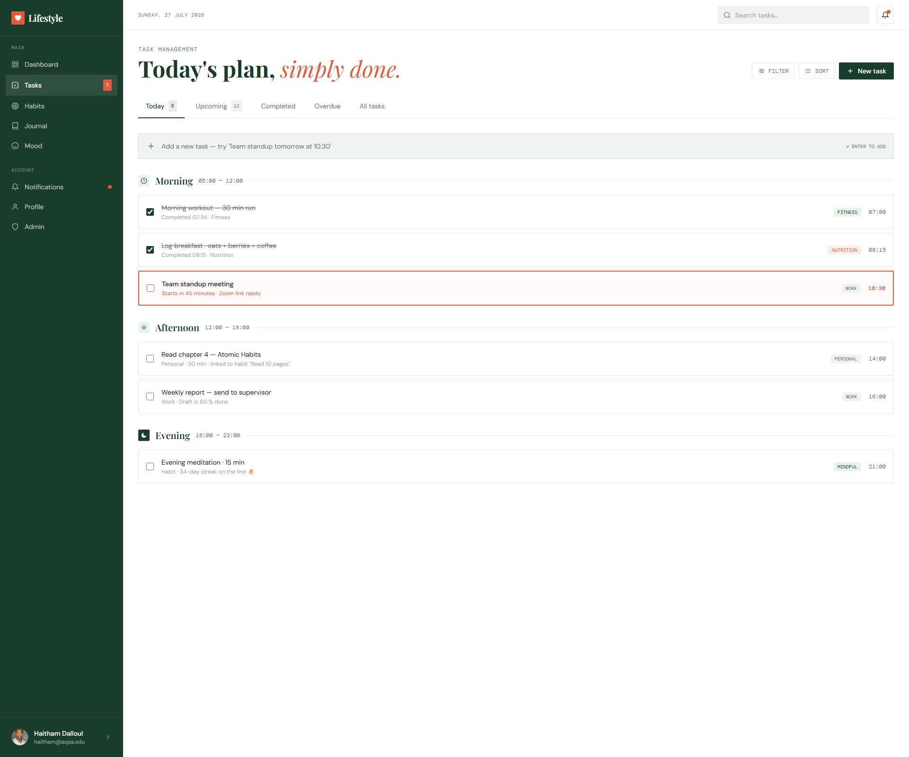
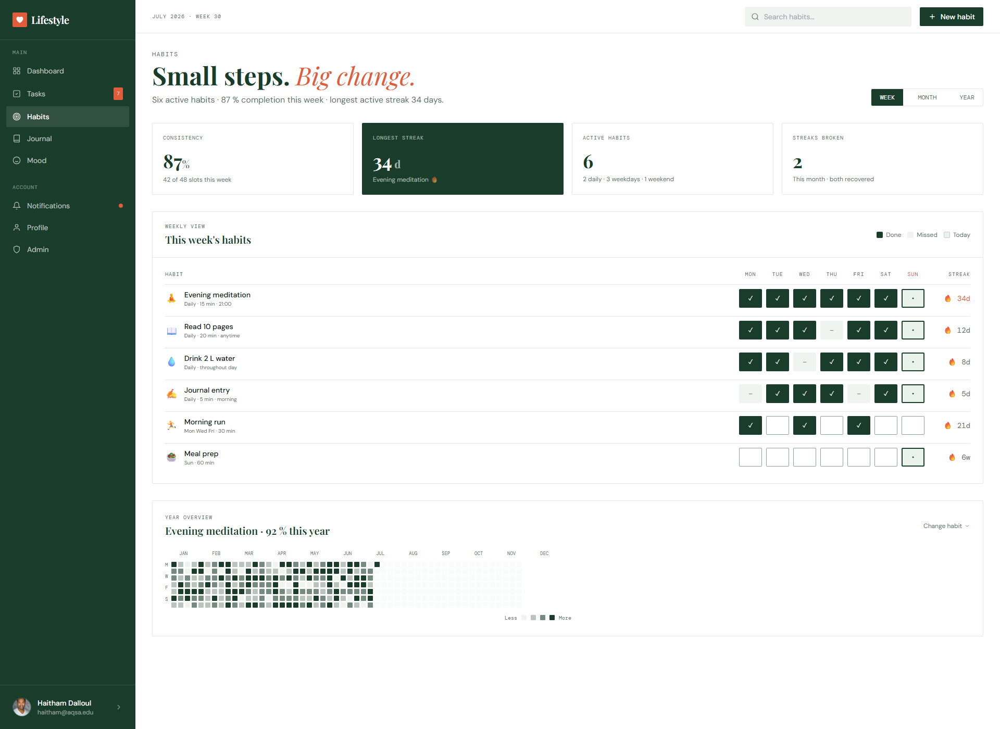
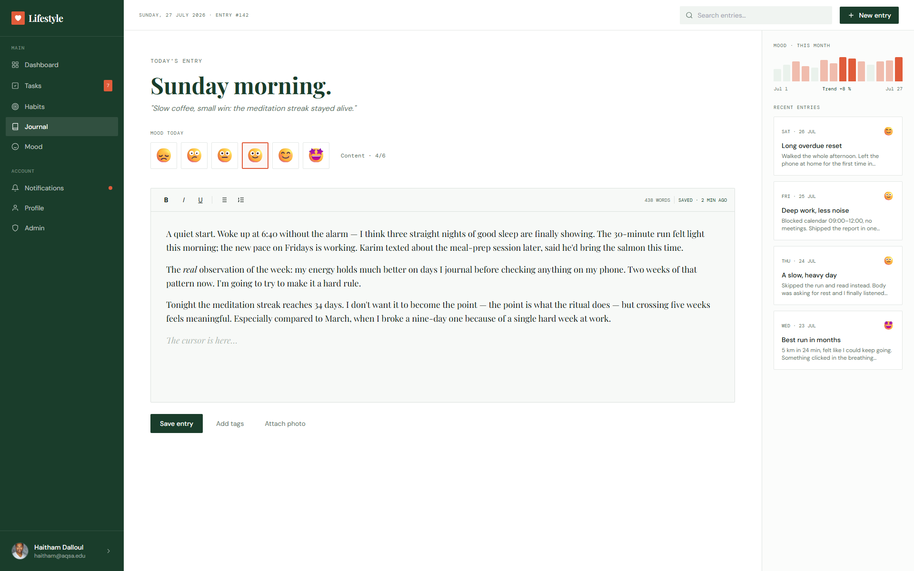
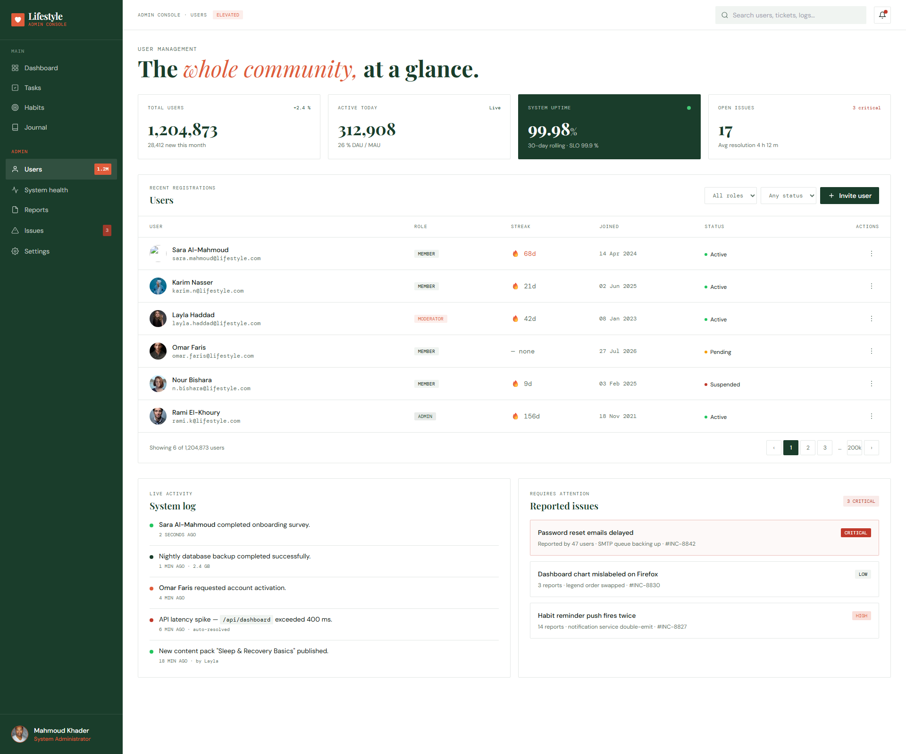

<div align="center">

# 🌿 Lifestyle Management System

**A full-stack Laravel 12 web application for managing tasks, habits, journal entries and mood — with a RESTful API, token authentication and an admin dashboard.**


</div>

---

## 📖 About

**Lifestyle Management System** helps users organise their daily life in one place: plan tasks, build habits, write journal entries and track their mood, while administrators monitor and manage user accounts.

The backend is a Laravel 12 REST API secured with **Laravel Sanctum**. The interface is a native Blade UI styled with **Tailwind CSS**, and the data is stored in **SQLite** by default (a MySQL template is included). The code is organised around clean-architecture principles and four classic design patterns.

---

## 🖼️ Screenshots

| Home | Login |
|:---:|:---:|
|  |  |
| **Register** | **Dashboard** |
|  |  |
| **Tasks** | **Habits** |
|  |  |
| **Journal** | **Admin Dashboard** |
|  |  |

---

## ✨ Features

| Feature | Description |
|---|---|
| 🔐 **Authentication** | Registration, login, logout and profile updates with Laravel Sanctum tokens |
| 📊 **Dashboard** | Personal dashboard with weekly statistics and an activity summary |
| ✅ **Tasks** | Full CRUD for tasks, plus marking a task as completed |
| 🔁 **Habits** | Create habits and tick them daily to track progress |
| 📝 **Journal** | Write, edit and delete journal entries |
| 😊 **Mood Tracking** | Log your mood and review its history |
| 🔔 **Notifications** | In-app notifications (read / delete), triggered automatically by task events |
| 👤 **Profile** | Manage personal account details |
| 🛡️ **Admin Panel** | Dashboard for monitoring users and activating / suspending accounts (`admin` middleware) |
| 🧪 **Automated Tests** | Unit and feature tests with PHPUnit |

---

## 🧩 Design Patterns

| Pattern | Purpose in this project | Key files |
|---|---|---|
| **Repository** | Controllers depend on an interface, not on Eloquent, so persistence can be swapped or mocked in tests | `app/Repositories/Contracts/TaskRepositoryInterface.php`, `app/Repositories/EloquentTaskRepository.php`, `app/Providers/AppServiceProvider.php` |
| **Observer** | When a task is completed, a notification is created and dispatched automatically, without extra code in controllers | `app/Observers/TaskObserver.php` (registered in `AppServiceProvider::boot()`) |
| **Strategy** | Notifications are sent through an interchangeable channel (Email, Push, SMS, Log) chosen at runtime | `app/Services/Notification/Contracts/NotificationChannel.php`, `app/Services/Notification/ChannelStrategy.php` |
| **Factory** | Realistic test and seed data in one line, with states such as `admin()`, `suspended()`, `completed()`, `overdue()` | `database/factories/UserFactory.php`, `database/factories/TaskFactory.php` |

The project also uses **MVC**, **Dependency Injection** (service-container bindings), **Form Requests** for validation and **Policies** for authorisation.
Full write-up: [`docs/03B-design-patterns.md`](docs/03B-design-patterns.md).

---

## 🛠️ Tech Stack

| Layer | Technology |
|---|---|
| Backend | Laravel 12 · PHP 8.2+ |
| Authentication | Laravel Sanctum |
| Database | SQLite (default) · MySQL (optional, see `.env.mysql.example`) |
| Frontend | Blade views · Tailwind CSS (Play CDN) · vanilla JavaScript |
| Testing | PHPUnit |

---

## 🚀 Getting Started

### Requirements

- PHP **8.2+** with the `mbstring`, `openssl`, `pdo_sqlite`, `sqlite3` and `fileinfo` extensions
- Composer
- An internet connection (the UI loads Google Fonts and the Tailwind Play CDN)

> No frontend build step is needed — `npm install` / `npm run dev` are **not** required.

### Option 1 — Windows quick start

From the project folder (the one containing `artisan`), run:

```bat
START-LIFESTYLE.bat
```

The launcher detects your PHP / XAMPP installation, creates a project-only `php.ini` in `.runtime-php/` with the required extensions enabled, prepares the SQLite database, runs the migrations and opens the app in your browser on a free port (8001, 8002, …). Your global PHP configuration is **not** modified.

Helper scripts:

| Script | Purpose |
|---|---|
| `DIAGNOSE-PHP.bat` | Shows the active PHP binary, `php.ini` files and loaded extensions |
| `RESET-DEMO-DATABASE.bat` | Restores the demo data |
| `VERIFY-PROJECT.ps1` | Checks the project setup |

### Option 2 — Manual setup (any OS)

Run these commands from the project root:

```bash
composer install
cp .env.example .env            # Windows (PowerShell): Copy-Item .env.example .env
php artisan key:generate
touch database/database.sqlite  # Windows (PowerShell): New-Item database/database.sqlite
php artisan migrate --seed
php artisan serve --host=127.0.0.1 --port=8001
```

Then open <http://127.0.0.1:8001>.

> On Windows, after running `START-LIFESTYLE.bat` once, you can start the server manually from the project root with:
> ```powershell
> $env:PHPRC = "$PWD\.runtime-php"
> php artisan serve --host=127.0.0.1 --port=8001
> ```

---

## 🔑 Demo Accounts

| Role | Email | Password |
|---|---|---|
| User | `user@lifestyle.test` | `Password123!` |
| Administrator | `admin@lifestyle.test` | `Admin123!` |

After signing in as an administrator, open `/admin/dashboard`.

---

## 🗺️ Routes

**Web pages**

```text
/                    /login               /register
/app/dashboard       /app/tasks           /app/habits
/app/journal         /app/mood            /app/notifications
/app/profile         /admin/dashboard
```

**REST API** (`/api`, protected by `auth:sanctum` except register/login)

| Method | Endpoint | Description |
|---|---|---|
| POST | `/api/register`, `/api/login` | Create an account / get a token |
| POST | `/api/logout` | Revoke the current token |
| GET · PATCH | `/api/me`, `/api/profile` | Current user / update profile |
| GET | `/api/dashboard` | Dashboard statistics |
| CRUD | `/api/tasks` · POST `/api/tasks/{task}/complete` | Tasks |
| CRUD | `/api/habits` · POST `/api/habits/{habit}/tick` | Habits |
| CRUD | `/api/journal` | Journal entries |
| GET · POST | `/api/mood` | Mood history / log a mood |
| GET · POST · DELETE | `/api/notifications`, `/api/notifications/{id}/read` | Notifications |
| GET · PATCH | `/api/admin/dashboard`, `/api/admin/users`, `/api/admin/users/{user}/status` | Admin only |

---

## 🧪 Testing

```bash
php artisan test
php artisan route:list --except-vendor
```

Testing documentation: [`docs/04-testing.md`](docs/04-testing.md).

---

## 📁 Project Structure

```text
app/                    Controllers, Models, Observers, Policies, Repositories, Services
database/               Migrations, factories, seeders, SQLite database
resources/views/        Blade views (native UI)
routes/                 web.php and api.php
tests/                  Unit and feature tests
docs/                   Backend, design-pattern and testing documentation
docs/notes/             Release, installation and validation notes
frontend-source/        Original static design pages, screenshots and React homepage
project-documentation/  Status report, Trello board and sequence diagram
screenshots/            Code-view screenshots used in the documentation
code-views/             Script that generates the code-view screenshots
```

---

## 📚 Documentation

- [Backend structure](docs/03A-backend-structure.md)
- [Design patterns](docs/03B-design-patterns.md)
- [Testing](docs/04-testing.md)
- [Windows installation guide (Arabic)](docs/notes/INSTALL_WINDOWS_AR.md)
- [Validation report](docs/notes/VALIDATION_REPORT.md)

---

## 👥 Team

| Name |
|---|
| **Haitham Dalloul**|
| **Mahmoud Khader**  |

## 🎓 Course

**Software Engineering**  — Dr. Firas Al-Ajla 
**Al-Aqsa University** 
